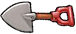
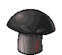

# PVZ 原图对照

从现成项目取得原图，不重新生图。以下GIF保留原有帧，文件未重绘。

| PVZ铲子 | 胆小菇 | 原毁灭菇 |
| --- | --- | --- |
|  |  |  |

2026-10-23按用户提供的原版参照，将胆小菇、毁灭菇待机帧与铲子转换后接入本地Demo；原始GIF保留在此，不直接进入构建。生产图集与来源记录见[src/renderer/assets/PVZ-PROVENANCE.json](../../src/renderer/assets/PVZ-PROVENANCE.json)，转换脚本为[scripts/pack-pvz-reference.py](../../scripts/pack-pvz-reference.py)。已检索的固定上游树没有LICENSE或单独素材许可，不能将其表述为已获开源素材授权，项目MIT不覆盖这些素材。仅采用待机图，不引入原游戏爆炸逻辑；旧生成资产保留。

来源：[NewPvzJs-v1.6](https://github.com/i-Eureka/NewPvzJs-v1.6/tree/6d4517524fe9f0bd6fb3bacbce6b537b951b74ac)，游戏原图对应Plants vs. Zombies（PopCap/EA）。逐项路径、SHA256、尺寸、帧数及许可检索情况见[PROVENANCE.json](PROVENANCE.json)。

`Shovel.png`是原工具槽底图，不是铲子；实际铲子为上表`Shovel.gif`。`shovel-first-frame.png`仅从该单帧GIF无重绘转换，供本地图片检查。
